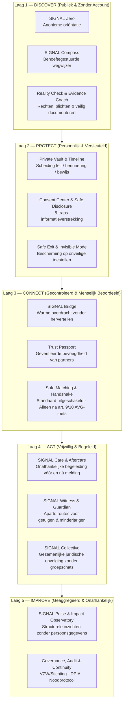

# SIGNAL — The Independent Trust Infrastructure

### Speak Safely. Connect Privately. No one should have to speak alone.

**Een onafhankelijk digitaal vertrouwensnetwerk waarin mensen ernstige mistoestanden veilig kunnen documenteren, deskundige hulp vinden en — waar rechtmatig en verantwoord — afzonderlijke signalen kunnen laten onderzoeken voor begeleide opvolging.**

**[Start hier](START-HERE.md)** · **[Masterplan 2026–2029 (v4.0)](MASTERPLAN.md)** · **[Product & Innovaties](docs/02-product-en-innovaties/signal-4.0-productfamilie.md)** · **[Architectuur & Security](docs/03-architectuur-en-beveiliging/systeemarchitectuur.md)** · **[AVG & Governance](docs/05-governance-en-financiering/governance-en-statutaire-waarborgen.md)** · **[Demo Blueprint (v4.0)](docs/07-demo-blueprint/signal-4.0-demo-specificatie.md)**

> **Status & Veiligheidskader:** Dit repository bevat de volledige productstrategie, systeemarchitectuur, juridische en ethische kaders (AVG art. 9/10, EU AI Act), governance-blauwdruk en UX-specificatie voor **SIGNAL 4.0**. Alle voorbeelden, dossiers en scenario's in deze repository zijn **100% fictief en synthetisch**. SIGNAL vervangt nooit politie, justitie of bestaande Belgische hulpverlening (zoals 1712, de Zorgcentra na Seksueel Geweld, Unia of het Vlaams Meldpunt), maar vormt de veilige brug ertussen.

---

## 1. De kernvraag achter SIGNAL

Wat als vijf mensen afzonderlijk iets ernstigs meemaken met dezelfde persoon of binnen dezelfde organisatie, maar geen van hen weet dat de andere vier bestaan?

Vandaag lopen slachtoffers en melders vast in een versnipperd landschap:
- **Drempelvrees en isolement:** Mensen durven niet alleen naar politie of meldpunten uit angst niet geloofd te worden, voor reputatieschade of voor represailles.
- **Verlies van overzicht en bewijs:** Ervaringen, berichten en tijdslijnen raken verspreid of gaan verloren voordat iemand klaar is voor een vervolgstap.
- **De sociale-mediaval:** Omdat veilige, laagdrempelige tussenvormen ontbreken, verschijnen verhalen soms pas jaren later op sociale media — met het risico op een publieke online schandpaal zonder rechtsbescherming voor melders én beschuldigden.

### De verschuiving naar SIGNAL 4.0
Het doel van SIGNAL is **niet** om zoveel mogelijk klachten centraal te verzamelen of een digitaal beschuldigingsregister te bouwen. De leidende ontwerpvragen zijn:

> **Hoe maken we het voor iemand veilig en eenvoudig om van twijfel of onzekerheid naar passende hulp of rechtmatige actie te gaan, zonder onnodig persoonsgegevens prijs te geven — en hoe verkorten we de tijd tussen een eerste ervaring en professionele bescherming?**

| Probleem vandaag | Wat SIGNAL oplost | Kernmodule |
|---|---|---|
| Mensen weten niet of hun ervaring "meldbaar" is of waar ze terechtkunnen | Oriënteren zonder account of persoonsgegevens; directe routering naar officiële Belgische instanties | **SIGNAL Zero & Compass** |
| Mensen durven nog geen formele klacht in te dienen, maar vergeten details | Chronologisch privéverslag met strikte scheiding tussen eigen herinnering, bewijsstukken en derden | **SIGNAL Timeline & Vault** |
| Mensen moeten hun traumatische verhaal telkens opnieuw vertellen | Warme, door de gebruiker gecontroleerde dossieroverdracht naar geverifieerde hulpverleners | **SIGNAL Bridge & Trust Passport** |
| Mensen denken dat ze volledig alleen staan | Gefaseerde, menselijk gecontroleerde overeenkomstdetectie onder strikte wettelijke voorwaarden | **Safe Matching & Handshake** |
| Sociale media worden een informele rechtbank | Begeleide, vertrouwelijke professionele en juridische opvolging met procedurele waarborgen | **SIGNAL Care & Collective** |

---

## 2. De SIGNAL 4.0 Architectuur: Vijf Lagen & Zes Domeinen

SIGNAL is ontworpen als een **federatief vertrouwensnetwerk** in plaats van één kwetsbare megadatabase met beschuldigingen.

### De zes samenwerkende productdomeinen
1. **Compass** — De juiste weg vinden zonder registratiedwang (`SIGNAL Zero`, `SIGNAL Compass`, `Reality Check`).
2. **Vault** — Veilig, tijdgestempeld documenteren op eigen tempo (`Timeline`, `Memory`, `Evidence Coach`, `Evidence Integrity`).
3. **Care** — Toegang tot erkende menselijke hulpverlening (`1712`, `ZSG`, `Unia`, `Vlaams Meldpunt`, `Aftercare`, `Guardian`).
4. **Network** — Gecontroleerde overdracht en samenwerking tussen onafhankelijke organisaties (`Bridge`, `Trust Passport`, `Connect API`, `Federation`).
5. **Justice** — Rechtmatige vervolgstappen met bescherming van alle betrokkenen (`Safe Matching`, `Handshake`, `Collective`, `Fairness`).
6. **Impact** — Privacyvriendelijke maatschappelijke signalering en wetenschappelijke evaluatie (`Pulse`, `Research`).

---

## 3. Acht ondersteunde categorieën & verantwoorde fasering

SIGNAL ondersteunt acht maatschappelijke domeinen via één rustige, toegankelijke ingang, maar met strikt gescheiden juridische workflows, bewaartermijnen en bevoegdheden:

| Golf | Categorieën | Focus in deze fase | Risicoprofiel |
|---|---|---|---|
| **Golf 1 (Start)** | 1. Pesten, intimidatie & machtsmisbruik 2. Consumentenmisstanden & oplichting | Intelligente routering (`Compass`), educatie (`Reality Check`) en beperkte persoonlijke tijdlijn (`Vault`) | Middel tot Hoog |
| **Golf 2 (Uitbreiding)** | 3. Bedrijfsfraude & klokkenluiden 4. Discriminatie 5. Online misbruik (stalking, afpersing, doxxing) 6. Milieu- en veiligheidsmisstanden | Warme overdracht (`SIGNAL Bridge`) naar gespecialiseerde partners (Unia, Federale Ombudsman, FIRM-IFDH, toezichthouders) | Hoog |
| **Golf 3 (Voorwaardelijk)** | 7. Seksueel grensoverschrijdend gedrag 8. Institutionele misstanden (zorg, onderwijs, jeugd) | Alleen met erkende partners (zoals ZSG / 1712) en uitsluitend na positieve DPIA, security-audit en expliciete juridische grondslag voor eventuele `Safe Matching` | Zeer hoog (Art. 9 & 10 AVG) |

---

## 4. Wat we absoluut NIET bouwen (Harde Rode Lijnen)

Om te voorkomen dat een beschermend platform verandert in een digitaal schandblok of een kwetsbaar doelwit voor misbruik, gelden ononderhandelbare ontwerp- en statutaire grenzen:

- **Geen digitaal beschuldigingsregister:** Nooit publieke namenlijsten, kaarten, rankings of tellers van meldingen tegen personen of organisaties.
- **Geen AI-waarheidsoordeel:** Geen AI die geloofwaardigheid, emoties of schuld beoordeelt. AI ondersteunt uitsluitend bij toegankelijke taal, vertaling en het chronologisch structureren van door de gebruiker geselecteerde notities.
- **Geen ongecontroleerde groepschats:** Melders worden nooit automatisch aan elkaar gekoppeld of in groepsdossiers geplaatst waarin getuigenissen elkaar kunnen beïnvloeden.
- **Geen beheerdersinzage in alle dossiers:** Platformbeheerders hebben geen inhoudelijke toegang tot individuele meldingen; identiteit, dossierinhoud en eventuele matchinggegevens zijn cryptografisch en logisch gescheiden.
- **Geen commerciële beïnvloeding:** Betalende organisaties (`SIGNAL Institutional`) kunnen nooit meldingen binnen het publieke netwerk (`SIGNAL Care`) inzien, verbergen of vertragen.
- **Geen misleidende juridische beloftes:** Een notitie of dossier in SIGNAL is géén proces-verbaal bij de politie en géén formele klokkenluidersmelding; gebruikers zien altijd exact wat een stap juridisch wel en niet betekent.

---

## 5. Repository-overzicht

| Map / Bestand | Inhoud |
|---|---|
| [`START-HERE.md`](START-HERE.md) | Leeswijzer op maat van hulpverleners, juristen/DPO's, architecten, productdesigners en bestuurders |
| [`MASTERPLAN.md`](MASTERPLAN.md) | Het integrale **SIGNAL Masterplan 2026–2029 (v4.0)** waarin alle conceptfases zijn samengebracht |
| [`docs/01-visie-en-probleemanalyse/`](docs/01-visie-en-probleemanalyse/probleemanalyse-en-context.md) | Maatschappelijke probleemanalyse, hypothese, categorie-evaluatie (8 domeinen) en Belgisch partnerlandschap |
| [`docs/02-product-en-innovaties/`](docs/02-product-en-innovaties/signal-4.0-productfamilie.md) | Uitwerking van de 6 productdomeinen, alle 27 deelinnovaties (`Compass`, `Bridge`, `Safe Disclosure`, enz.) en rode lijnen |
| [`docs/03-architectuur-en-beveiliging/`](docs/03-architectuur-en-beveiliging/systeemarchitectuur.md) | Modulaire systeemarchitectuur, cryptografische scheiding, EU AI Act-kader en `SIGNAL Connect API`-contracten |
| [`docs/04-juridisch-en-privacy/`](docs/04-juridisch-en-privacy/avg-gdpr-en-rechtsgronden.md) | AVG art. 6/9/10-analyse, DPIA- en mensenrechtenraamwerk, veiligheidskader en de 5 pre-build kernbeslissingen |
| [`docs/05-governance-en-financiering/`](docs/05-governance-en-financiering/governance-en-statutaire-waarborgen.md) | Belgische VZW/Stichting-structuur, 6 toezichtsorganen, statutaire onafhankelijkheidsregels, budget en KPI's |
| [`docs/06-adr/`](docs/06-adr/ADR-001-federatief-vertrouwensnetwerk-boven-centrale-database.md) | Architectuur- en ontwerpbeslissingen (ADR-001 t/m ADR-005) |
| [`docs/07-demo-blueprint/`](docs/07-demo-blueprint/signal-4.0-demo-specificatie.md) | Volledige UX/UI-specificatie van de 10 interactieve SIGNAL 4.0-schermen + synthetische scenario- en testdata |

---

## 6. Roadmap van Concept naar Europese Standaard

1. **Fase 0 — Probleem- en Juridische Validatie (Maand 0–3):** Toetsing van de architectuur en rechtsgronden bij Belgische slachtofferorganisaties (1712, ZSG, Unia), advocaten en privacy-experts (GBA/DPO).
2. **Fase 1 — Interactieve SIGNAL 4.0 Productdemo & Haalbaarheidsdossier (Maand 3–6):** Volledig klikbare demonstratieomgeving met uitsluitend synthetische dossiers (`Compass`, `Vault`, `Bridge`, `Trust Passport`, `Handshake Simulator`, `Professional Workspace`) voor validatie bij partners en financiers.
3. **Fase 2 — Beveiligde Navigator & Beperkte Pilot (Maand 6–12):** Lancering van `SIGNAL Zero`, `SIGNAL Compass` en gecontroleerde doorverwijzing met één erkende partnerorganisatie na afgeronde DPIA en penetratietest.
4. **Fase 3 — Gecontroleerde Samenwerking & Matching-onderzoek (Maand 12–24, voorwaardelijk):** Activering van `SIGNAL Bridge` en — uitsluitend waar wettelijk toegelaten — begeleide overeenkomstdetectie binnen een strikt afgebakend domein.
5. **Fase 4 — Federatief Benelux/EU-netwerk (Maand 24–36+):** Meertalige uitrol, `SIGNAL Connect API`-standaardisatie en grensoverschrijdende interoperabiliteit tussen onafhankelijke hulpinstanties.

---

## Licentie & Verantwoording

- **Code, configuraties, datamodellen en democomponenten:** MIT-licentie.
- **Documentatie, architectuurblauwdrukken en governancekaders:** Creative Commons Attribution 4.0 International (CC BY 4.0) — zie [`LICENSE`](LICENSE).
- **Onafhankelijkheid:** Dit project is een onafhankelijk maatschappelijk en technologisch ontwerp- en onderzoeksinitiatief. Genoemde publieke instellingen (1712, ZSG, Unia, Vlaams Meldpunt, Federale Ombudsman, FIRM-IFDH, Callisto, GlobaLeaks) dienen als referentie voor het bestaande ecosysteem en impliceren geen formele affiliatie of goedkeuring.
