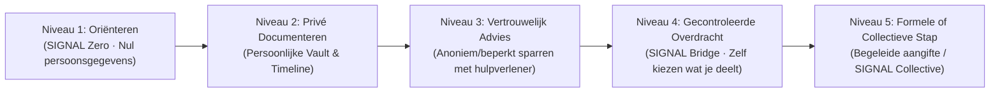

# Kerninnovaties & Feature-specificaties (SIGNAL 1.0 → 4.0)

Dit document bundelt alle **27 productinnovaties** die tijdens de uitwerking van SIGNAL zijn gedefinieerd, inclusief hun werking, gebruikersreis en prioritering (`P0` t/m `P3`).

---

## 1. Prioriteitenmatrix (Alle Innovaties in Één Oogopslag)

| # | Module / Innovatie | Domein | Wat voegt het toe? | Gebruikerswaarde | Complexiteit | Prioriteit |
|---|---|---|---|---|---|---|
| 1 | **SIGNAL Zero** | Compass | Oriënteren en hulp vinden zonder account, login of persoonsgegevens | 5/5 | 1/5 | **P0** |
| 2 | **SIGNAL Compass** | Compass | Behoeftegestuurde intake (*"Wat heb je nu nodig?"*) i.p.v. een klachtenformulier | 5/5 | 2/5 | **P0** |
| 3 | **Safe Exit & Invisible Mode** | Vault | Discrete weergave op onveilige toestellen, snelle uitgang en eerlijke uitleg over sporen | 5/5 | 2/5 | **P0** |
| 4 | **SIGNAL Reality Check** | Compass | Neutrale uitleg over rechten, bewijswaarde en wat een stap juridisch wél/niet doet | 5/5 | 2/5 | **P0** |
| 5 | **Safe Disclosure (5 niveaus)** | Vault | Stapsgewijze informatieverstrekking: van nul data naar vrijwillige overdracht | 5/5 | 3/5 | **P0** |
| 6 | **Consent Center** | Vault | Granulair beheren en intrekken van toestemming per gegeven en per doel | 5/5 | 3/5 | **P0** |
| 7 | **Verified Help Network** | Care | Gecureerde wegwijzer naar officiële Belgische hulplijnen en meldpunten (1712, ZSG, Unia...) | 5/5 | 2/5 | **P0** |
| 8 | **SIGNAL Timeline & Memory** | Vault | Chronologisch dossier met scheiding tussen herinnering (zeker/onzeker), bewijs en derden | 5/5 | 3/5 | **P0** |
| 9 | **SIGNAL Aftercare** | Care | Ondersteuning ná een melding: gespreksvoorbereiding en vrijwillige check-ins | 5/5 | 2/5 | **P0** |
| 10 | **SIGNAL Bridge** | Network | Warme, gecontroleerde dossieroverdracht zodat melders niet telkens opnieuw moeten beginnen | 5/5 | 4/5 | **P1** |
| 11 | **SIGNAL Trust Passport** | Network | Controleerbaar profiel van elke organisatie (bevoegdheid, DPO, toezicht) | 5/5 | 3/5 | **P1** |
| 12 | **SIGNAL Witness** | Care | Aparte, afgebakende route voor getuigen, collega's en omstanders | 4/5 | 3/5 | **P1** |
| 13 | **SIGNAL Guardian** | Care | Specifieke bescherming en escalatieroutes voor minderjarigen en kwetsbare groepen | 5/5 | 4/5 | **P1** |
| 14 | **SIGNAL Evidence Coach** | Vault | Educatie over veilig en rechtmatig bewaren van screenshots, berichten en metadata | 4/5 | 2/5 | **P1** |
| 15 | **Evidence Vault & Integrity** | Vault | Versleutelde opslag met SHA-256 hashing, tijdstempels en toegangslogboek | 4/5 | 4/5 | **P1** |
| 16 | **Independent Advocate** | Care | Toegang tot onafhankelijke vertrouwenspersonen en gespecialiseerde behandelaars | 5/5 | 4/5 | **P1** |
| 17 | **Confidential Messaging** | Care | Asynchroon, versleuteld berichtenkanaal zonder gevoelige e-mailnotificaties | 4/5 | 3/5 | **P1** |
| 18 | **Anonymous Access Options** | Vault | Dossiercode / herstelsleutel of Passkey zonder verplicht identificeerbaar e-mailadres | 4/5 | 3/5 | **P1** |
| 19 | **Accessibility Layer** | Compass | Eenvoudige taal (B1), meertaligheid (NL/FR/DE/EN) en schermlezer-optimalisatie | 5/5 | 3/5 | **P1** |
| 20 | **AI Dossier Assistant** | Vault | Strikt begrensde hulp bij chronologisch structureren en vertalen (nooit waarheidsoordeel) | 3/5 | 3/5 | **P2** |
| 21 | **Safe Matching** | Justice | Privacy-preserving detectie van mogelijke overeenkomsten (standaard uitgeschakeld in MVP) | 5/5 | 5/5 | **P2** |
| 22 | **SIGNAL Handshake** | Justice | Menselijk gecontroleerde, individuele kennismakings- en begeleidingsprocedure bij een match | 5/5 | 5/5 | **P2** |
| 23 | **SIGNAL Collective** | Justice | Begeleide gezamenlijke juridische opvolging via een advocaat zonder groepschats | 4/5 | 5/5 | **P2** |
| 24 | **SIGNAL Fairness** | Justice | Procedurele waarborgen tegen valse meldingen en bescherming van rechten van beschuldigden | 5/5 | 4/5 | **P2** |
| 25 | **SIGNAL Continuity** | Impact | Nood-, export- en overdrachtsprotocol voor als SIGNAL ooit stopt of uitvalt | 5/5 | 3/5 | **P2** |
| 26 | **SIGNAL Federation & Connect API** | Network | Federatieve standaard zodat organisaties samenwerken zonder één centrale megadatabase | 5/5 | 5/5 | **P2** |
| 27 | **SIGNAL Pulse & Research** | Impact | Geaggregeerde maatschappelijke inzichten (k-anoniem) en wetenschappelijk effectiviteitsonderzoek | 3/5 | 3/5 | **P3** |

---

## 2. Uitwerking van de Belangrijkste Kernmodules

### A. `SIGNAL Compass` & `SIGNAL Zero` — De Intelligente Wegwijzer
In plaats van een dwingend klachtenformulier start een gebruiker in `SIGNAL Compass` met vijf herkenbare menselijke startvragen:
1. *"Ik weet niet of wat er gebeurd is meldbaar of ernstig genoeg is."* → Opent `Reality Check` met rustige voorbeelden en definities per categorie, zonder dat iets wordt opgeslagen.
2. *"Ik wil iets voor mezelf vastleggen voordat ik details vergeet."* → Opent uitleg over `SIGNAL Timeline` en `Evidence Coach`.
3. *"Ik wil veilig met iemand kunnen praten."* → Toont direct de juiste erkende hulplijn (`1712`, `ZSG`, `Vlaams Meldpunt`, `Unia`) met hun `Trust Passport`.
4. *"Ik ben getuige of collega en maak me zorgen om iemand anders."* → Activeert de `SIGNAL Witness`-route.
5. *"Ik wil weten hoe ik een officiële melding of aangifte kan voorbereiden."* → Toont de formele routes (politie, Federale Ombudsman, inspectiediensten) en hoe `SIGNAL Bridge` kan helpen bij de voorbereiding.

### B. `Safe Disclosure` — Vijf Niveaus van Informatieverstrekking
Gebruikers worden nooit gedwongen om meteen alles prijs te geven. Zij bewegen vrij tussen vijf niveaus:

*Belangrijk:* Dit is geen verplichte trap. Wie in acuut gevaar verkeert of direct naar een Zorgcentrum na Seksueel Geweld (ZSG) of de politie wil, kan Niveau 2 t/m 4 direct overslaan.

### C. `SIGNAL Timeline` & `SIGNAL Memory` — Zuivere Dossieropbouw
Een groot juridisch probleem bij informele klachten is dat feiten, latere gesprekken en geruchten door elkaar gaan lopen. `SIGNAL Timeline` dwingt een heldere scheiding af tussen vijf typen items:
1. **Eigen herinnering (`Memory`):** Wat heeft de melder zelf gezien of meegemaakt? Inclusief de mogelijkheid om gebeurtenissen uit het verleden te reconstrueren én expliciet aan te geven welke details **zeker** zijn (bijv. *"Het was na het eindejaarsfeest"*) en welke **onzeker** zijn (bijv. *"Ik twijfel of het 14 of 15 december was"*). De software vult nooit zelf gaten in.
2. **Bestaande documenten of berichten (`Evidence`):** Screenshots, e-mails, contracten of foto's met automatische SHA-256 integriteitshash en upload-tijdstempel.
3. **Verklaringen of observaties van derden (`Third-party info`):** Duidelijk gemarkeerd als *"Gehoord van..."* of gekoppeld aan een aparte `SIGNAL Witness`-verklaring.
4. **Latere aanvullingen of correcties (`Addendum`):** Oorspronkelijke notities worden nooit stilletjes overschreven; een correctie wordt als nieuwe versie naast het origineel bewaard zodat de authenticiteit aantoonbaar blijft.
5. **Gezette officiële stappen (`Action Log`):** Wanneer is contact opgenomen met HR, een vertrouwenspersoon, 1712, een ZSG of de politie?

### D. `SIGNAL Bridge` & `SIGNAL Trust Passport` — Warme Overdracht zonder Hervertellen
Wanneer iemand besluit om hulp in te schakelen, voorkomt `SIGNAL Bridge` dat die persoon zijn hele verhaal vanaf nul moet herhalen:
1. **Samenstellen:** De gebruiker vinkt in zijn `Timeline` aan welke gebeurtenissen en bijlagen hij in het overdrachtspakket wil opnemen.
2. **Ontvanger controleren (`Trust Passport`):** De gebruiker ziet het geverifieerde profiel van de ontvangende organisatie (bijv. *Vlaams Meldpunt* of *Unia*): wie is de verwerkingsverantwoordelijke, geldt er beroepsgeheim, wat gebeurt er na ontvangst, en wie houdt onafhankelijk toezicht?
3. **Bewuste verzending:** Pas na expliciete, geïnformeerde toestemming (`Consent Center`) wordt het geselecteerde pakket versleuteld overgedragen.
4. **Transparante status:** De gebruiker ontvangt een technische ontvangstbevestiging van de partnerorganisatie, zonder dat SIGNAL zelf een fictieve "onderzoeksstatus" verzint.

### E. `Safe Matching` & `SIGNAL Handshake` — Patroonherkenning met Menselijke Waarborgen
*(Standaard technisch uitgeschakeld in de eerste release; uitsluitend te activeren na positieve DPIA en wettelijke grondslag onder art. 9/10 AVG).*

Hoe werkt `SIGNAL Handshake` wanneer een domein wettelijk is vrijgegeven?
1. **Strikt beperkte vergelijking:** Alleen wanneer twee melders afzonderlijk en met expliciete toestemming kiezen voor patrooncontrole binnen een toegelaten domein, vergelijkt een geïsoleerde dienst vooraf gedefinieerde, gestandaardiseerde kenmerken (rekening houdend met aliassen, spelvarianten en tijdsvensters).
2. **Geen automatische notificatie:** Bij een potentiële technische overeenkomst krijgt **geen enkele melder** automatisch een bericht (*"Er is een match!"*). Een technische overeenkomst bewijst immers nog geen patroon of schuld en kan ook berusten op naamgenoten of gecoördineerd misbruik.
3. **Vierogencontrole door gemachtigd reviewteam:** Twee onafhankelijke, tot geheimhouding verplichte professionals beoordelen of het signaal inhoudelijk en juridisch opvolgbaar is.
4. **Individuele benadering (`Handshake`):** De melders worden **afzonderlijk** benaderd door een onafhankelijke vertrouwenspersoon of advocaat. Zij krijgen uitleg over hun opties zonder dat de identiteit of het verhaal van de andere melder wordt prijsgegeven.
5. **Begeleide samenwerking (`SIGNAL Collective`):** Alleen als beide melders na individueel juridisch advies vrijwillig instemmen, kan een gemachtigde advocaat of bevoegde instantie een gecoördineerde procedure voorbereiden — zonder dat de melders in een informele groepschat elkaars getuigenis beïnvloeden.
