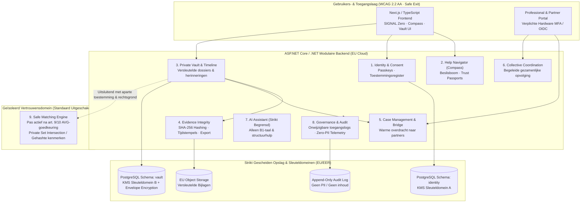

# Technische Systeemarchitectuur: Gescheiden Vertrouwensdomeinen

## 1. Architectuurfilosofie: Modulaire Monoliet → Federatief Vertrouwensnetwerk

Voor de opbouw van SIGNAL hoeven we niet te beginnen met twintig losse microservices die moeilijk te beveiligen en te onderhouden zijn. We kiezen voor een **modulaire monoliet met harde interne beveiligings- en cryptografische grenzen**, waarbij de meest gevoelige onderdelen (zoals de persoonlijke kluis en een eventuele latere matchingdienst) logisch én op databaseniveau strikt gescheiden zijn.

Op lange termijn fungeert SIGNAL als een **federatief netwerk**: de openbare wegwijzer (`SIGNAL Compass`), de kennisbank en de technische overdrachtsstandaard (`SIGNAL Connect API`) worden centraal aangeboden, terwijl erkende partnerorganisaties hun eigen toegewezen dossiers binnen hun eigen wettelijke bevoegdheid beheren.

---

## 2. Conceptueel Systeemdiagram (9 Kernmodules)

---

## 3. De Negen Kernmodules en hun MVP-status

| # | Module | Kernfunctie | In Eerste MVP (Fase 1/2)? |
|---|---|---|---|
| **1** | **Identity & Consent** | Scheiding van identiteit en verhaal, ondersteuning voor `SIGNAL Zero` (geen login), Passkeys en granulair toestemmingsbeheer (`Consent Center`). | **Ja** |
| **2** | **Help Navigator (`Compass`)** | Behoeftegestuurde beslisboom, `Reality Check` en overzicht van Belgische hulpinstanties met hun `Trust Passport`. | **Ja** |
| **3** | **Private Vault (`Timeline`)** | Persoonlijke verslagen, chronologische tijdlijn (`Memory`) met scheiding tussen feit, herinnering en derdenverklaring. | **Ja, beperkt & sterk afgeschermd** |
| **4** | **Evidence Integrity** | Berekenen van SHA-256 hashes bij upload, tijdregistratie, toegangslogboek en veilige export (`SIGNAL Continuity`). | **Ja, basaal** |
| **5** | **Case Management & `Bridge`** | Samenstellen van een gecontroleerd overdrachtspakket en opvolging door gemachtigde professionals bij partnerorganisaties. | **Fase 2 (met 1e partner)** |
| **6** | **Safe Matching** | Detecteren van mogelijk verwante meldingen op basis van strikt afgebakende kenmerken, gevolgd door menselijke beoordeling (`Handshake`). | **Nee — technisch uitgeschakeld tot na juridische toelating** |
| **7** | **Collective Coordination** | Begeleide samenwerking tussen melders en een gemachtigde advocaat/organisatie zonder groepschats. | **Later (Fase 3)** |
| **8** | **AI Assistant** | Optionele, afgeschermde hulp bij leesbaarheid (B1), vertaling en structurering zonder toegang tot ruwe dossiers. | **Later, strikt beperkt** |
| **9** | **Governance & Audit** | Onwijzigbare registratie van elke dossierhandeling, misbruikdetectie, incidentbeheer en nalevingscontrole. | **Ja** |

---

## 4. Voorgestelde Technologie-stack

| Onderdeel | Technologiekeuze | Waarom deze keuze voor SIGNAL? |
|---|---|---|
| **Frontend** | **Next.js, TypeScript, Tailwind CSS**, Radix/shadcn toegankelijke primitives | Sterke ondersteuning voor WCAG 2.2 AA (schermlezers, toetsenbordnavigatie), server-side minimalisatie en directe `Safe Exit`-interactie. |
| **Backend** | **ASP.NET Core / .NET (C#)** | Zeer sterke typeveiligheid, ingebouwde ondersteuning voor beleid-gebaseerde autorisatie (*Policy-based Authorization*), cryptografie en lange-termijn enterprise-onderhoudbaarheid. |
| **Database** | **PostgreSQL** met gescheiden schema's en Row-Level Security (RLS) | Maakt het mogelijk om `identity`, `vault`, `bridge` en `audit` in aparte schema's met afzonderlijke database-rollen en toegangsrechten onder te brengen. |
| **Bestandsopslag** | **Versleutelde Object Storage binnen de EU/EER** | Gevoelige bijlagen vallen nooit buiten de Europese rechtsmacht (geen US CLOUD Act-blootstelling bij keuze voor soevereine EU-hosting). |
| **Authenticatie** | **OIDC, WebAuthn / Passkeys, Hardware MFA (FIDO2)** | Gebruikers kunnen een kluis beveiligen zonder herleidbaar werk-e-mailadres; hulpverleners en beoordelaars zijn verplicht tot phishing-bestendige MFA. |
| **Sleutelbeheer** | **Managed KMS / HSM** met gescheiden sleuteldomeinen | Envelope encryption per dossier zodat een database-dump zonder bijbehorende KMS-autorisatie en gebruikerssleutel onleesbaar is. |
| **Monitoring** | **Privacy-first Operationele Telemetrie** | Systeemgezondheid en foutpercentages worden gemeten zonder IP-adressen, namen of tekstvelden te loggen. |
| **CI/CD & Security** | **GitHub Actions**, SAST, Dependency Audits, SBOM | Elke wijziging wordt automatisch gecontroleerd op kwetsbaarheden vóór uitrol naar geïsoleerde test- en productieomgevingen. |
