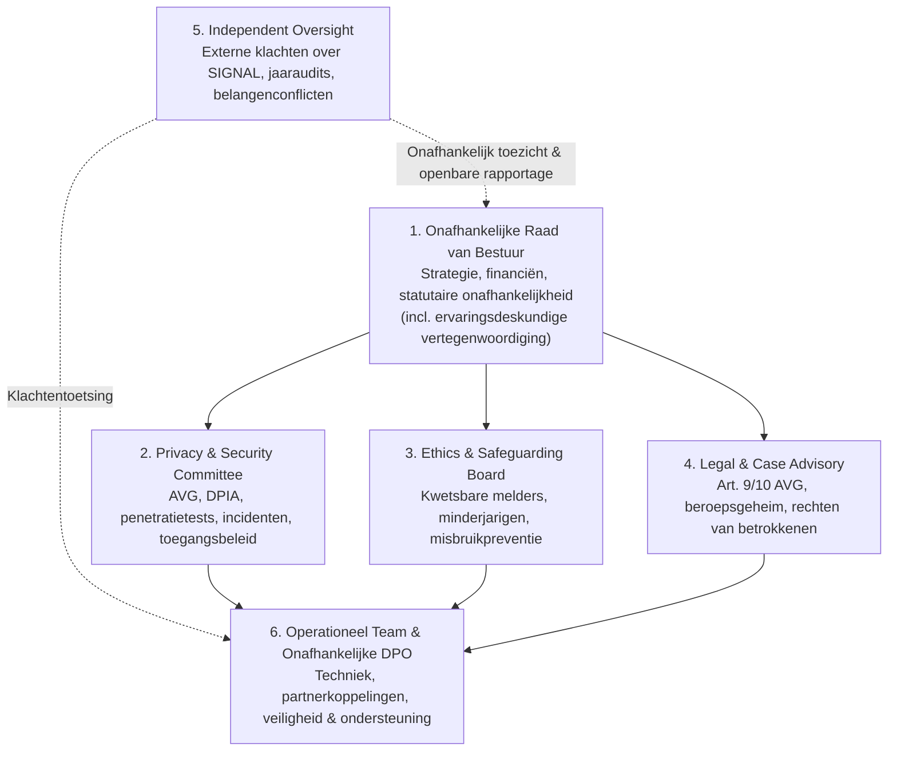

# Governance, Machtsevenwicht & Statutaire Onafhankelijkheidsregels

Bij een vertrouwensinfrastructuur voor ernstige mistoestanden is **governance minstens zo belangrijk als de softwarecode**. Gebruikers en partnerorganisaties moeten de garantie hebben dat geen enkele bestuurder, politicus, sponsor of systeembeheerder dossiers kan manipuleren of onderdrukken.

---

## 1. De Zes Governance-organen van SIGNAL (Belgische VZW / Stichting)

---

## 2. Beslissingsmatrix: Wie Beslist Wat?

Om machtsconcentratie en belangenverstrengeling uit te sluiten, is elke kritieke beslissing binnen SIGNAL toegewezen aan een specifiek orgaan met vastgelegde checks-and-balances:

| Beslissing | Eindverantwoordelijke | Verplichte Toetsing / Vetorecht |
|---|---|---|
| **Productstrategie & Nieuwe Categorieën** | Raad van Bestuur | Voorafgaande maatschappelijke, ethische (`ESB`) en juridische (`LCA`) toetsing |
| **Verwerken van Gevoelige Gegevens (Art. 9/10 AVG)** | Verwerkingsverantwoordelijke (Bestuur) | Bindend juridisch advies (`LCA`) en formeel DPO-toezicht (DPO adviseert en controleert onafhankelijk, maar neemt niet de bestuurdersaansprakelijkheid over) |
| **Activeren van `Safe Matching` in een Domein** | Raad van Bestuur (unaniem) | Positieve DPIA (`PSC`), wettelijke grondslag (`LCA`), goedkeuring `ESB` én overeenkomst met bevoegde partner |
| **Behandelen van een Beveiligingsincident / Datalek** | Security Lead & Incident Response Team | Directe melding aan DPO en `PSC`; wettelijke melding aan GBA binnen 72 uur waar van toepassing |
| **Individuele Dossieropvolging na Overdracht** | Bevoegde professionele behandelaar (bij partnerorganisatie) | Binnen het wettelijk kader en beroepsgeheim van de betreffende organisatie; bestuur/beheerder heeft **geen** inzage |
| **Onderzoeken van een Mogelijke Match (`Handshake`)** | Apart gemachtigd Reviewteam (vierogenprincipe) | Volledig gescheiden van systeembeheer en algemeen bestuur |
| **Informatie Delen met Derden / Justitie** | Bevoegde dossierhouder / melder zelf | Uitsluitend met expliciete toestemming van de melder (`SIGNAL Bridge`) of op grond van een dwingende wettelijke plicht / rechterlijk bevel |
| **Toelaten van een AI-hulpfunctie** | Raad van Bestuur | Gedocumenteerde EU AI Act-risicoanalyse, DPIA (`PSC`) en ethische goedkeuring (`ESB`) |
| **Behandelen van een Klacht tégen SIGNAL** | **Independent Oversight** (Extern Klachtenmechanisme) | Volledig onafhankelijk van het operationeel team en het dagelijks bestuur |

---

## 3. De Acht Statutaire Onafhankelijkheidsregels

Deze acht principes worden onwijzigbaar verankerd in de oprichtingsstatuten van de VZW of Stichting achter SIGNAL:

1. **Absoluut Verbod op Dataverkoop:** Persoonsgegevens, meldingen, metadata of gedragsgegevens worden onder geen enkel beding verkocht, verhuurd of commercieel geëxploiteerd.
2. **Geen Advertenties of Tracking:** Het platform bevat nooit advertentienetwerken, commerciële trackers of gedragsgerichte profilering.
3. **Geen Betaalde Onderdrukking van Dossiers:** Er bestaat geen enkele commerciële of contractuele mogelijkheid voor bedrijven, instellingen of individuen om meldingen tegen zichzelf te laten blokkeren, vertragen of verwijderen buiten het normale wettelijke kader om.
4. **Geen Dossierinzage door Financiers of Klanten:** Subsidiegevers, donateurs, filantropische fondsen en klanten van `SIGNAL Institutional` krijgen onder geen enkele voorwaarde inzage in individuele dossiers.
5. **Openbaar Jaarverslag:** Jaarlijks publiceert SIGNAL een transparant verslag met financiële verantwoording, nalevingsstatistieken en zorgvuldig geaggregeerde (k-anonieme) maatschappelijke cijfers.
6. **Jaarlijkse Onafhankelijke Beveiligings- en Governance-audit:** Een externe, gecertificeerde partij toetst jaarlijks zowel de informatiebeveiliging als de naleving van de toegangsscheiding; de samenvatting van deze audit is openbaar.
7. **Strikte Regeling bij Belangenconflicten:** Bestuursleden, adviseurs en reviewteamleden melden elk potentieel belangenconflict vooraf en onthouden zich verplicht van elke beraadslaging of toegang wanneer een organisatie of sector uit hun eigen netwerk betrokken is.
8. **Verplicht Continuïteits- en Noodplan (`SIGNAL Continuity`):** De organisatie houdt een geoormerkte reserve en technische exportprocedure aan zodat gebruikers hun gegevens altijd veilig kunnen meenemen of wissen, ook indien SIGNAL zou ophouden te bestaan.

---

## 4. Vertegenwoordiging van Ervaringsdeskundigheid

SIGNAL ontwerpt niet *over* melders zonder *met* hen te spreken. Binnen de **Ethics & Safeguarding Board** en de klankbordgroepen wordt structureel ruimte gereserveerd voor mensen met relevante ervaringsdeskundigheid (slachtoffers, klokkenluiders en veldwerkers), op een veilige manier waardoor niemand verplicht wordt om zijn of haar persoonlijke getuigenis publiek te maken om mee te kunnen denken.
