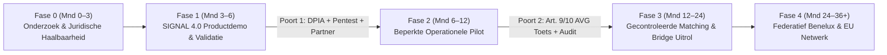

# Ontwikkelroadmap (Fase 0–4) & Ethische Impact-KPI's

## 1. Gefaseerde Roadmap (0 tot 36+ Maanden)

Elke overgang naar een volgende fase is gekoppeld aan een harde **Go/No-Go veiligheidspoort**. De operationele pilot (Fase 2) en eventuele patroonherkenning (Fase 3) starten pas na expliciete juridische en beveiligingsgoedkeuring.

### Overzicht per Fase

| Fase | Richttermijn | Kernopleveringen | Wat we in deze fase bewust NIET doen |
|---|---|---|---|
| **Fase 0 — Onderzoek & Haalbaarheid** | Maand 0–3 | - Stakeholder-interviews (slachtofferzorg, advocaten, DPO's) - Juridische toets art. 6, 9, 10 AVG & Belgische klokkenluiderswet - Beantwoording van de 5 pre-build kernbeslissingen | Geen echte gebruikers of meldingen aannemen. |
| **Fase 1 — Publieke Demo & Navigatieprototype** | Maand 3–6 | - **SIGNAL 4.0 Klikbare Productdemo** (10 schermen, synthetische dossiers) - Gebruikerstests op rust, begrijpelijkheid (B1) en toegankelijkheid - Haalbaarheidsdossier voor Belgische partners en fondsen | Geen productiebackend voor gevoelige persoonsgegevens openstellen. |
| **Fase 2 — Beperkte Operationele Pilot** | Maand 6–12 *(voorwaardelijk)* | - Livegang `SIGNAL Zero` & `SIGNAL Compass` (anonieme wegwijzer) - Beveiligde `Private Vault` en eerste `SIGNAL Bridge`-overdracht met **één erkende partnerorganisatie** na afgeronde DPIA en penetratietest | `Safe Matching` blijft technisch uitgeschakeld; geen brede onbegeleide openstelling van alle 8 categorieën. |
| **Fase 3 — Gecontroleerde Matching & Coördinatie** | Maand 12–24 *(voorwaardelijk)* | - Uitbreiding van `SIGNAL Bridge` naar meerdere Belgische partners (`Trust Passport`) - Onderzoek en (indien aantoonbaar rechtmatig) gecontroleerde pilot van `Safe Matching & Handshake` binnen één strikt afgebakend domein | Geen automatische matches zonder vierogencontrole; geen groepschats tussen melders. |
| **Fase 4 — Benelux & Europese Federatie** | Maand 24–36+ *(ambitie)* | - Volledige meertaligheid (NL/FR/DE/EN) - Standaardisatie van de `SIGNAL Connect API` - Federatieve samenwerking tussen onafhankelijke nationale instanties | Geen centralisatie van Europese dossiers in één enkele database. |

---

## 2. Ethische Impact-KPI's: Hoe Bewijzen we dat SIGNAL Echt Werkt?

Een maatschappelijk vertrouwensplatform mag **nooit** worden afgerekend op *"zoveel mogelijk beschuldigingen verzamelen"* of *"zoveel mogelijk media-aandacht genereren"*. Meer meldingen is op zichzelf geen succesindicator; **veiliger handelen, snellere toegang tot passende hulp en betere rechtsbescherming** wél.

Wij meten succes aan de hand van acht kwalitatieve en privacyvriendelijke KPI's:

| # | KPI | Wat meet je precies? | Waarom deze indicator telt |
|---|---|---|---|
| **1** | **Successful Routing Rate** | Percentage bezoekers in `SIGNAL Compass` dat binnen één sessie de juiste, bevoegde hulpinstantie of informatie vindt. | Bewijst dat SIGNAL de versnippering van het Belgische hulplandschap daadwerkelijk oplost. |
| **2** | **Time to Guidance** | De tijd tussen een eerste bezoek aan het platform en het vinden van bruikbare eerste informatie of een passend hulpkanaal. | Verkort de periode waarin mensen alleen en zonder overzicht rondlopen. |
| **3** | **User Understanding** | Begrijpen gebruikers in bruikbaarheidstests exact wat hun registratie juridisch wél en níét betekent (bijv. dat een kluisnotitie geen politierapport is)? | Voorkomt schijnveiligheid en gevaarlijke misverstanden. |
| **4** | **Consent Comprehension** | Percentage testgebruikers dat in het `Consent Center` en bij `SIGNAL Bridge` foutloos kan aanwijzen welke gegevens met welke ontvanger worden gedeeld. | Maakt geïnformeerde toestemming (AVG) echt betekenisvol in plaats van een juridische formaliteit. |
| **5** | **Accessibility Score** | Slaagpercentage voor mensen met een visuele beperking, motorische beperking of lage digitale/taalvaardigheid (WCAG 2.2 AA & B1-leesbaarheid). | Zorgt ervoor dat kwetsbare groepen niet worden buitengesloten. |
| **6** | **Security & Privacy Incident Rate** | Aantal ongeautoriseerde toegangspogingen, datalekken of PII-lekken in logs (Doelstelling: **0**). | Vertrouwen kan maar één keer worden verloren. |
| **7** | **Misuse Prevention Accuracy** | Effectiviteit van misbruik- en sybil-detectie op synthetische aanvalsscenario's, inclusief het voorkomen van onterechte blokkeringen van echte hulpzoekenden. | Beschermt zowel het platform als personen tegen kwaadwillige valse meldingen (`SIGNAL Fairness`). |
| **8** | **Partner Follow-through** | Percentage succesvolle, complete `SIGNAL Bridge`-overdrachten waarbij de ontvangende partner bevestigt dat het dossier bruikbaar en binnen haar bevoegdheid is (zonder dat de melder alles opnieuw moest vertellen). | Toont de concrete meerwaarde voor zowel de melder als de hulpverleningssector. |

### Validatie van `Safe Matching` met Synthetische Testdossiers
Voordat een matching-algoritme ooit op echte gegevens mag worden overwogen, wordt het uitsluitend getest op een uitgebreide set **synthetische testdossiers** (inclusief naamgenoten, spelvarianten, vage tijdsaanduidingen en gesimuleerde kwaadwillige lastercampagnes) om zowel **fout-positieven** (*false positives*) als **gemiste overeenkomsten** (*false negatives*) wetenschappelijk in kaart te brengen.
